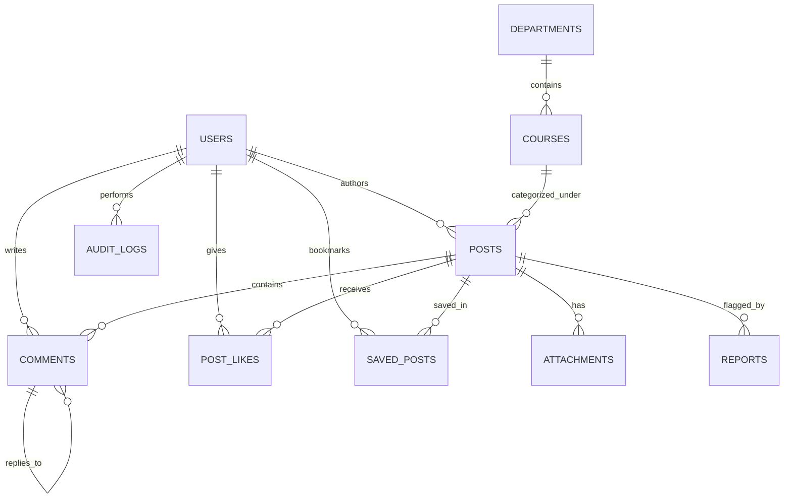

# UniverseDIU — Database Schema & Data Dictionary (DATABASE.md)

## 1. Relational Entity-Relationship Diagram

---

## 2. Table Schemas

### 2.1 `users`
| Column | Type | Constraints | Description |
|---|---|---|---|
| `id` | INTEGER | PRIMARY KEY AUTOINCREMENT | Unique user identifier |
| `name` | TEXT | NOT NULL | Full name of student/faculty |
| `email` | TEXT | UNIQUE NOT NULL | DIU university email (`@diu.edu.bd`) |
| `student_id` | TEXT | UNIQUE | DIU student ID (e.g. `201-15-14231`) |
| `password_hash`| TEXT | NOT NULL | Bcrypt hashed password |
| `role` | TEXT | DEFAULT 'STUDENT' | `STUDENT`, `MODERATOR`, `ADMIN`, `SUPER_ADMIN` |
| `department` | TEXT | DEFAULT 'Software Engineering'| Enrolled department |
| `batch` | TEXT | DEFAULT '43' | Enrolled batch number |
| `avatar_url` | TEXT | | Link to avatar image |
| `knowledge_points` | INTEGER | DEFAULT 0 | Gamified academic points |
| `status` | TEXT | DEFAULT 'ACTIVE' | `ACTIVE`, `SUSPENDED`, `BANNED` |
| `created_at` | DATETIME | DEFAULT CURRENT_TIMESTAMP | Registration timestamp |

### 2.2 `departments` & `courses`
- `departments`: `id`, `code` (e.g. `SWE`, `CSE`), `name`, `created_at`.
- `courses`: `id`, `code` (e.g. `SE-322`), `name` (*Web Application Lab*), `department_id`, `semester` (*Spring 2026*), `instructor_name`, `instructor_title`, `description`.

### 2.3 `posts`
| Column | Type | Constraints | Description |
|---|---|---|---|
| `id` | INTEGER | PRIMARY KEY AUTOINCREMENT | Unique post ID |
| `author_id` | INTEGER | REFERENCES users(id) | Post author |
| `course_id` | INTEGER | REFERENCES courses(id) | Associated course (e.g. SE-322) |
| `type` | TEXT | DEFAULT 'Knowledge' | `Knowledge`, `Resource`, `Question`, `Project` |
| `title` | TEXT | NOT NULL | Headline/Topic title |
| `content` | TEXT | NOT NULL | Markdown content & description |
| `tags` | TEXT | NOT NULL | JSON string array of tags (`["React", "Express"]`) |
| `helpful_count` | INTEGER | DEFAULT 0 | Cached count of helpful upvotes |
| `comments_count`| INTEGER | DEFAULT 0 | Cached count of comments |
| `status` | TEXT | DEFAULT 'PUBLISHED' | `PUBLISHED`, `HIDDEN`, `REMOVED` |
| `created_at` | DATETIME | DEFAULT CURRENT_TIMESTAMP | Creation timestamp |

### 2.4 `attachments`
- `id`: INTEGER PK
- `post_id`: INTEGER REFERENCES posts(id)
- `file_name`: TEXT (`React_CRUD_Tutorial.pdf`)
- `file_size`: TEXT (`2.4 MB`)
- `file_type`: TEXT (`PDF`, `Video`, `Link`)
- `file_url`: TEXT

### 2.5 `comments`
- `id`: INTEGER PK
- `post_id`: INTEGER REFERENCES posts(id)
- `author_id`: INTEGER REFERENCES users(id)
- `parent_comment_id`: INTEGER NULLABLE (for nested replies)
- `content`: TEXT NOT NULL
- `helpful_count`: INTEGER DEFAULT 0
- `created_at`: DATETIME DEFAULT CURRENT_TIMESTAMP

### 2.6 `post_likes` & `saved_posts`
- `post_likes`: `user_id`, `post_id`, `created_at` (PRIMARY KEY (`user_id`, `post_id`))
- `saved_posts`: `user_id`, `post_id`, `created_at` (PRIMARY KEY (`user_id`, `post_id`))

### 2.7 `reports` (Content Moderation Queue)
- `id`: INTEGER PK
- `post_id`: INTEGER REFERENCES posts(id)
- `reporter_id`: INTEGER REFERENCES users(id)
- `reason`: TEXT NOT NULL (`Inappropriate content`, `Spam post`, `Fake resource`, `Harassment`)
- `status`: TEXT DEFAULT 'PENDING' (`PENDING`, `RESOLVED`, `DISMISSED`)
- `created_at`: DATETIME DEFAULT CURRENT_TIMESTAMP

### 2.8 `audit_logs` (Security & Administration Tracking)
- `id`: INTEGER PK
- `actor_id`: INTEGER REFERENCES users(id)
- `action`: TEXT NOT NULL (`ROLE_CHANGE`, `CONTENT_MODERATE`, `USER_SUSPEND`)
- `target_type`: TEXT NOT NULL (`USER`, `POST`, `REPORT`)
- `target_id`: INTEGER NOT NULL
- `details`: TEXT (JSON summary)
- `created_at`: DATETIME DEFAULT CURRENT_TIMESTAMP
